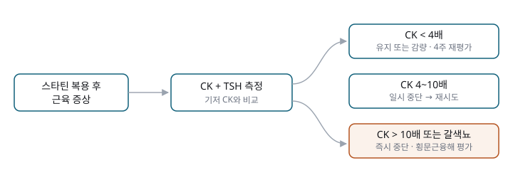

> **한 줄 정리** — 스타틴 복용 후 근육 증상이 생기면 먼저 **CK와 갑상선기능(TSH)** 을 확인하고,
> 횡문근융해(CK > 10배, 갈색뇨, 급성 신손상)가 아니면 약을 끊기보다 **원인 평가 후 재시도**가 원칙임.

**기출 맥락** — 스타틴을 시작한 지 6주 된 환자가 "허벅지가 뻐근하다"고 호소하는 형태로 반복 출제됨.
함정은 두 가지임.

1. 근육 증상만으로 바로 중단하는 것 → 대부분은 **nocebo**이거나 다른 원인(갑상선기능저하, 비타민 D 결핍, 운동)
2. CK를 보지 않고 "정상 범위"라고 단정하는 것 → [기저 CK]{.underline}가 없으면 비교 기준이 없음

## 접근 순서

| 단계 | 할 일 | 판단 기준 |
|---|---|---|
| 1 | 증상 양상 확인 | 근력 저하·전신 근육통·갈색뇨 여부 |
| 2 | CK 측정 | 정상 상한의 4배 미만 / 4~10배 / 10배 초과 |
| 3 | 이차 원인 배제 | TSH, 비타민 D, 신기능, 병용약 |
| 4 | 조치 결정 | 아래 표 |

## CK 층화별 처치

| CK | 증상 | 처치 |
|---|---|---|
| 정상~4배 | 경미 | 유지 또는 감량, 4주 후 재평가 |
| 4~10배 | 중등도 | 일시 중단 → 증상 소실 후 저용량 또는 다른 스타틴으로 재시도 |
| >10배 | 있음 | 즉시 중단, 수액·신기능 확인, 횡문근융해 평가 |
| >10배 | 없음 | 반복 측정으로 확인 후 개별 판단 (운동·외상 원인 흔함) |

## 재시도 전략

- **스타틴 휴약 후 재투여**로 인과관계를 확인함. 증상이 재현되면 SAMS로 봄.
- 재시도 시에는 **친수성 스타틴**(로수바스타틴, 프라바스타틴) 또는 **저용량 + 비스타틴 병용**(에제티미브)을 고려함.
- 고강도 스타틴이 꼭 필요한 2차 예방 환자에서는 SAMS를 이유로 치료를 완전히 포기하지 않음.

> **시험 포인트** — "스타틴 중단"이 정답인 경우는 CK > 10배이거나 횡문근융해 소견이 동반될 때뿐임.

## 헷갈리는 것

- **스타틴 간독성**: ALT > 3배 + 증상, 또는 > 5배면 중단. 근육 증상과 별개로 평가함.
- **피브레이트 병용**: 근육 독성 위험이 커짐. 특히 **gemfibrozil** 병용은 피함.
- **갑상선기능저하**: 스타틴 근육 증상을 악화시키는 대표적 이차 원인. TSH를 반드시 봄.